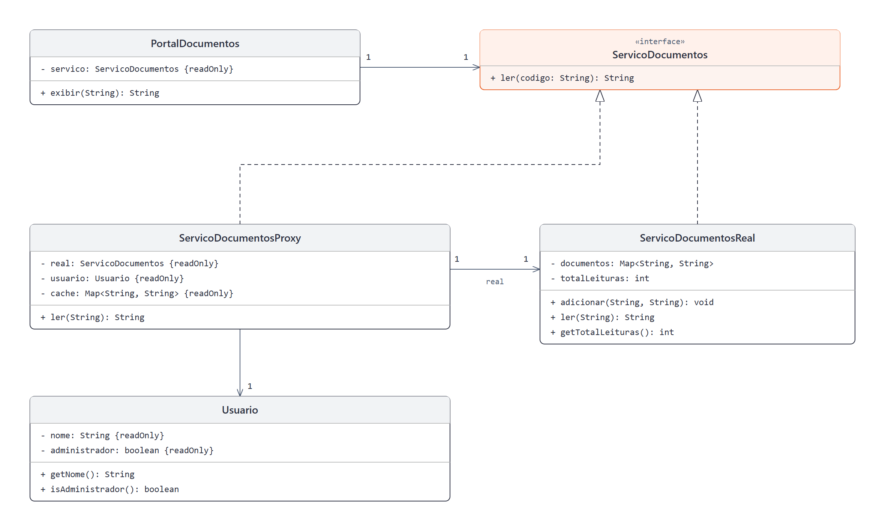

# DCC078 - Padrões de Projeto: Proxy

**Aluno:** Felipe Lazzarini Cunha

## Tema

O projeto representa um portal de documentos corporativos cujo acesso ao armazenamento é custoso e cujos documentos confidenciais só podem ser lidos por administradores. O Proxy controla o acesso ao serviço real e mantém um cache das leituras, sem que o portal perceba a diferença.

## Diagrama de Classes UML



## Estrutura do Projeto

- `ServicoDocumentos`: interface comum ao serviço real e ao proxy.
- `ServicoDocumentosReal`: objeto real que lê os documentos do armazenamento.
- `ServicoDocumentosProxy`: proxy de proteção e de cache que controla o acesso ao serviço real.
- `Usuario`: define o perfil usado na verificação de acesso.
- `PortalDocumentos`: cliente que exibe documentos usando apenas `ServicoDocumentos`.

## Testes

Com JDK 11 ou superior e Maven:

```bash
mvn test
```
